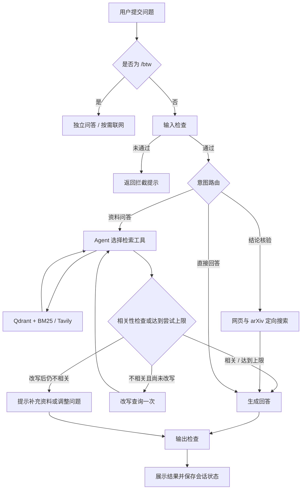

# Papeer｜面向研究与技术调研的 AI 知识工作台

**把分散的论文、网页和本地文档转化为可提问、可核验、可持续追问的知识工作流。**

Papeer 是一个基于 RAG 与 Agent 的研究助手，覆盖资料导入、混合检索、问答生成、结论核验和会话管理。项目以研究与技术调研为切入点，探索如何将“查资料—找依据—判断结论—继续研究”的人工流程，转化为可交互的 AI 产品。

相比功能数量，项目更关注三个问题：**用户能否快速进入任务、回答是否有资料支撑、系统能否在效果与成本之间形成可控的交付方案。**

> 当前定位：具备交互界面、后端工作流与离线评估脚本的应用原型。本文按当前代码描述功能；营销场景属于迁移方案，后续规划不代表已上线能力。

[English README](README.md) · [产品演示](#产品演示) · [快速开始](#快速开始) · [评估与迭代](#评估与迭代)

## 1. 从用户任务出发定义产品

### 目标用户与核心任务

| 用户 | 典型任务 | 希望获得的结果 |
| --- | --- | --- |
| 研究者与学生 | 阅读多篇论文，理解方法与结论 | 更快定位与问题有关的资料 |
| 技术产品经理 | 调研技术路线与适用条件 | 用资料支撑方案判断，降低检索与整理负担 |
| AI 应用开发者 | 查询实现细节，核验技术观点 | 在同一工作台中完成查证与追问 |

核心用户任务是：**当我需要理解一个技术问题时，希望系统从已有资料中找到相关依据，并帮助核验观点，以便形成下一步研究或方案决策。**

### 痛点如何转化为功能

以下是基于任务流程拆解的产品假设，尚不等同于客户访谈结论。

| 任务中的阻碍 | 产品方案 | 验收关注点 |
| --- | --- | --- |
| 资料散落在 PDF、网页和论文平台 | 统一导入 PDF、TXT、Markdown、网页与 arXiv 论文 | 资料能入库、能检索、能按标题删除 |
| 用户表述与原文用词不同，单一路径易漏检 | 语义检索与 BM25 关键词检索融合 | 术语精确问题与自然语言问题均能找到依据 |
| 第一轮检索效果差，用户需要反复换问法 | 相关性检查与一次查询改写 | 无依据时能明确提示，而非持续空转 |
| 旧论文中的结论可能需要重新查证 | 联网搜索与 arXiv 定向搜索 | 提供核验摘要及相关论文链接 |
| 多个研究主题的上下文容易混杂 | 每会话独立向量集合与检查点 | 切换会话后能恢复对应研究记录 |
| 临时问题打断研究主线 | `/btw` 独立旁路 | 临时问答不写入研究会话状态 |

### MVP 范围与优先级

首要闭环是：**导入资料 → 提问 → 获取基于上下文的回答 → 继续追问**。围绕这个闭环，再增加结论核验、会话恢复和质量评估。

采用 Streamlit 承载交互，是为了优先验证知识工作流，减少原型阶段独立前端与接口层的实现成本。账户权限、多人协作、扫描件 OCR、图表理解和业务系统集成留到后续验证，不扩大首版交付范围。

## 2. 产品演示

以下为仓库已有演示截图，界面与模型配置可能与当前版本存在差异。

| 研究工作台 | 问答交互 |
| --- | --- |
|  |  |

### 一次完整的使用流程

1. 创建研究会话，例如“RAG 检索方案调研”。
2. 上传论文或文档，也可导入网页、通过 arXiv ID 或标题获取论文。
3. 提问：“根据上传的资料，解释这一方法的适用条件与局限。”
4. 系统选择处理路径，检索相关内容；必要时检查相关性并改写查询。
5. 如需查证结论，提交核验问题，查看核验摘要与最多三篇相关论文链接。
6. 将相关论文继续导入知识库，推进下一轮研究；临时概念问题使用 `/btw`。

这个流程把“理解资料”和“寻找下一份资料”连接起来，让问答成为研究任务的一部分。

## 3. AI Native 工作流与技术方案

AI 在本项目中承担意图判断、工具选择、查询改写、结论整理与内容检查；应用代码负责状态、工具执行、持久化和流程边界。



### 关键设计与取舍

| 设计 | 实现 | 产品与工程考虑 |
| --- | --- | --- |
| 多路径处理 | LangGraph 路由到检索、核验或直接回答 | 不让所有问题都付出同样的检索成本 |
| 混合检索 | Qdrant 向量检索与 BM25，权重 0.7 / 0.3 | 同时覆盖语义近似与精确术语；权重仍需按数据集验证 |
| 可选重排 | 候选数量为 `max(3 × k, 12)`，Cohere 重排后保留前 k 条 | 提升上下文筛选能力，同时允许未配置或调用失败时降级 |
| 有界纠错 | 检索尝试上限设为 3，查询最多改写 1 次 | 限制持续重试；待执行工具调用仍优先完成以保持历史一致性 |
| 模型配置集中管理 | `model_config.py` 统一创建 Qwen / Ollama 对话模型 | 切换模型时减少业务逻辑改动 |
| 分层存储 | Qdrant 存向量，SQLite 存检查点，JSON 存会话元数据 | 分开管理检索数据、对话状态与界面信息 |
| 嵌入缓存 | 按模型与维度划分本地缓存命名空间 | 复用嵌入结果，减少重复计算 |
| 输入输出检查 | 本地规则与 Guardrails AI 检查 | 增加异常输入与无依据输出的控制环节 |

当前文档分块大小为 1000 字符、重叠为 200 字符。PDF 解析保留页面等元数据，文档块统一标记标题，便于资料管理。**普通问答尚未强制输出逐条引用，来源定位与答案引用是下一步需要补齐的产品能力。**

### 当前技术栈

| 层次 | 技术 |
| --- | --- |
| 交互界面 | Python、Streamlit、CSS |
| Agent 与工作流 | LangGraph、LangChain、Pydantic 结构化输出 |
| 对话模型 | 阿里云百炼 Qwen；可切换 Ollama |
| 向量模型 | Qwen `text-embedding-v4`，默认维度 1024 |
| 检索与排序 | Qdrant、BM25、可选 Cohere Rerank |
| 文档处理 | PyMuPDF、LangChain loaders、递归文本分块 |
| 联网搜索 | Tavily；arXiv 文档获取 |
| 质量与追踪 | DeepEval、Guardrails AI、可选 LangSmith |
| 持久化 | SQLite、JSON、本地嵌入缓存 |
| 部署相关配置 | Docker、Terraform、AWS ECS / ECR / EFS / CloudWatch、GitHub Actions |

## 4. 评估与迭代

### 用指标识别问题，而不是只观察回答是否流畅

`evaluate.py` 基于 `documents/Openclaw_Research_Report.pdf` 构建评估样本，记录回答与检索上下文，并通过 DeepEval 评估五项指标，默认通过阈值为 0.7。评估使用独立 SQLite 检查点和新建会话，减少与日常会话状态的混用。

仓库现有 `eval_results.json` 包含 **10 条样本**。以下为该文件的历史结果汇总，均值保留两位小数：

| 指标 | 平均分 | 通过样本 |
| --- | --- | --- |
| 上下文精确度 Contextual Precision | 0.98 | 10 / 10 |
| 上下文召回率 Contextual Recall | 1.00 | 10 / 10 |
| 上下文相关性 Contextual Relevancy | 0.58 | 5 / 10 |
| 回答相关性 Answer Relevancy | 0.99 | 10 / 10 |
| 忠实度 Faithfulness | 0.98 | 10 / 10 |

这组结果揭示了一个值得优先处理的问题：**回答指标较高，但检索上下文仍存在噪声。** 因此，下一轮优化应聚焦分块策略、候选数量与重排效果，并通过同一测试集进行对照实验。

这些结果来自小规模单文档历史评估，缺少完整运行时间和模型配置记录，不能视为当前 Qwen 版本的复测结论，也不能据此声明重排带来的提升幅度。仓库尚无足够的可复现记录支撑响应耗时、成本节省或部署速度的量化承诺。

### 下一轮验证计划

| 验证方向 | 方法 | 支持的产品决策 |
| --- | --- | --- |
| 检索质量 | 固定测试集比较向量检索、混合检索、混合检索加重排 | 是否值得承担重排成本 |
| 使用效率 | 记录首次有效回答时间、任务完成率和人工修正次数 | 工作台是否减少了用户操作负担 |
| 运行成本 | 统计每次成功任务的模型、嵌入与搜索调用成本 | 如何选择模型与重试预算 |
| 稳定性 | 统计服务超时、降级与无结果比例 | 哪些链路需要优先加固 |
| 可核验性 | 检查结论与原文对应关系、引用正确率 | 是否具备支撑业务判断的条件 |

## 5. 面向业务场景的迁移思路

本项目的已实现入口是研究资料，底层能力可以用于营销与售前知识工作流。迁移前，需要先明确业务角色、资料权限和答案验收标准。

| 可探索的业务场景 | 使用资料 | 可复用能力 | 需要新增的能力 |
| --- | --- | --- | --- |
| 营销产品知识助手 | 产品手册、活动规则、历史 FAQ | 文档导入、检索问答、内容检查 | 规则版本管理、引用展示、业务审核 |
| 竞品与行业调研 | 竞品资料、官网、行业报告 | 多来源导入、联网核验、独立会话 | 来源时效标记、对比模板、报告导出 |
| 售前方案支持 | 产品能力文档、案例与方案资料 | 知识检索、模型路由、持续追问 | 客户需求表、权限控制、人工确认环节 |

### 如何将业务需求落成可验收方案

计划采用以下推进方法，而不是在需求未明确前扩展功能：

1. **理解真实任务**：明确谁在什么场景下使用，收集真实问题、常用资料和当前人工步骤。
2. **确认成功标准**：与业务方约定哪些问题可以自动回答、哪些必须转人工，以及回答需要哪些证据。
3. **确定首版边界**：选择一个高频任务和一组可管理的资料，优先完成端到端闭环。
4. **以样本验收**：整理典型问题、困难问题和拒答问题，比较任务完成率、引用质量与使用耗时。
5. **根据反馈迭代**：把失败归因到资料缺失、检索噪声、模型生成或交互问题，再决定下一轮投入。

该部分体现产品落地方法与可迁移性，不代表已有营销客户项目或客户交付经历。

## 6. 快速开始

### 环境与依赖

使用 Python 3.12 或以上版本。在项目根目录执行：

```powershell
python -m venv .venv
.venv\Scripts\Activate.ps1
python -m pip install -r requirements.txt
```

当前模型适配以 `requirements.txt` 为安装入口，其中包含 Ollama 适配依赖；`pyproject.toml` 仍保留部分历史依赖，后续需统一。

### 配置环境变量

在根目录创建 `.env`，将示例值替换为实际配置：

```ini
LLM_PROVIDER=qwen
EMBEDDING_PROVIDER=qwen
DASHSCOPE_API_KEY=your_dashscope_api_key
DASHSCOPE_BASE_URL=https://dashscope.aliyuncs.com/compatible-mode/v1
QWEN_CHAT_MODEL=qwen3.6-flash
QWEN_EMBEDDING_MODEL=text-embedding-v4
EMBEDDING_DIM=1024

QDRANT_URL=your_qdrant_url
QDRANT_API_KEY=your_qdrant_api_key
TAVILY_API_KEY=your_tavily_api_key

# 可选：不配置时使用原始混合检索结果
COHERE_API_KEY=

# 可选：开启 LangSmith 追踪时填写
LANGCHAIN_TRACING_V2=false
LANGCHAIN_API_KEY=
LANGCHAIN_PROJECT=papeer

# 会话元数据与检查点目录
PAPEER_DATA_DIR=.
```

当前后端会初始化联网检索工具，运行完整应用时需配置 Tavily。模型名称应填写账户实际可调用的型号；修改向量维度后，不应继续使用维度不兼容的旧集合。

如需使用本地对话模型，安装并启动 Ollama、准备支持工具调用与结构化输出的模型，再修改：

```ini
LLM_PROVIDER=ollama
OLLAMA_BASE_URL=http://localhost:11434
OLLAMA_MODEL=llama3.2:3b
```

这里切换的是对话模型；嵌入仍使用 Qwen，向量存储与联网搜索仍依赖外部服务。不同本地模型的工具调用表现需要单独验证。

### 启动与评估

```powershell
streamlit run app.py
```

浏览器访问 `http://localhost:8501`，创建会话并导入资料后开始提问。

运行离线评估：

```powershell
python evaluate.py
```

评估脚本当前使用 `gpt-4o-mini` 作为评判模型，另需配置 `OPENAI_API_KEY`；它与应用的 Qwen / Ollama 对话模型配置分开。结果写入 `eval_results.json`，评估过程会创建 Qdrant 集合，脚本尚未自动清理这些集合。

## 7. 工程交付与当前边界

项目提供 Dockerfile、Terraform 基础设施与 GitHub Actions 部署工作流，覆盖容器构建、ECR 镜像推送和 ECS 服务更新路径。这些文件展示了云端交付方案，**当前版本仍需完成配置同步与实际部署验收**：

- `deploy.py` 和 Terraform 仍传递 Groq / Google 配置，需同步为当前 Qwen / Ollama 所需变量。
- Dockerfile 的基础镜像为 Python 3.11，而项目要求 Python 3.12+，容器环境与依赖安装方式需统一验证。
- GitHub Actions 提供构建部署流程，尚未包含自动测试与 RAG 质量门禁。
- Qdrant 按会话隔离数据，但尚无账户认证与用户级访问授权，不能等同于多租户权限隔离。
- 输入与输出校验中的部分模型调用异常会放行，后续需结合业务风险设置更明确的失败策略。
- 当前 Cohere 配置使用英语重排模型，中文业务资料的检索与重排效果需要专项评估。

因此，当前成果适合演示原型与技术方案；企业级上线需要进一步补齐认证、引用、可观测性与部署验证。

## 8. 项目结构

```text
app.py                       交互界面、资料导入与会话管理
backend/
  model_config.py            Qwen / Ollama 对话模型与 Qwen 嵌入配置
  paper_loader.py            文档解析、网页与 arXiv 获取、分块
  vector_store.py            Qdrant、BM25、重排与嵌入缓存
  rag_graph.py               意图路由、工具调用、改写、核验与生成
  guardrails.py              输入与输出检查
  btw_handler.py             独立临时问答旁路
  models.py                  结构化输出定义
evaluate.py                  离线质量评估
eval_results.json            历史评估结果
documents/                   基准文档与本地资料
static/                      界面样式
assets/                      项目演示截图
terraform/                   AWS 基础设施配置
.github/workflows/deploy.yml 镜像构建与 ECS 更新流程
Dockerfile                   容器构建定义
deploy.py                    基础设施部署入口
```

## 9. 下一阶段产品路线

| 优先级 | 工作 | 预期解决的问题 |
| --- | --- | --- |
| P0 | 统一模型、依赖与部署配置，完成端到端复测 | 本地可演示与云端可交付之间的差距 |
| P0 | 增加来源、页码引用与证据展示 | 用户难以判断回答依据 |
| P1 | 扩充中英文、多文档与无答案评测集，保留运行配置 | 当前样本不足以评估真实使用效果 |
| P1 | 加入阶段耗时、调用成本与失败原因统计 | 难以定位体验与成本瓶颈 |
| P1 | 引入用户认证、资料权限和更严格的异常策略 | 从个人原型走向团队试用 |
| P2 | 选择营销或售前单一场景进行用户访谈与试点 | 验证能力迁移是否产生实际业务价值 |

项目体现的能力链路是：**用户任务拆解 → 产品范围定义 → AI 工作流设计 → 交互与后端实现 → 数据持久化 → 质量评估 → 部署方案与迭代规划。**

求职展示时，个人贡献、客户对接经历、AI 编程工具使用方式与上线结果，应结合实际提交记录和交付材料说明；本 README 不替代这些事实证据。
